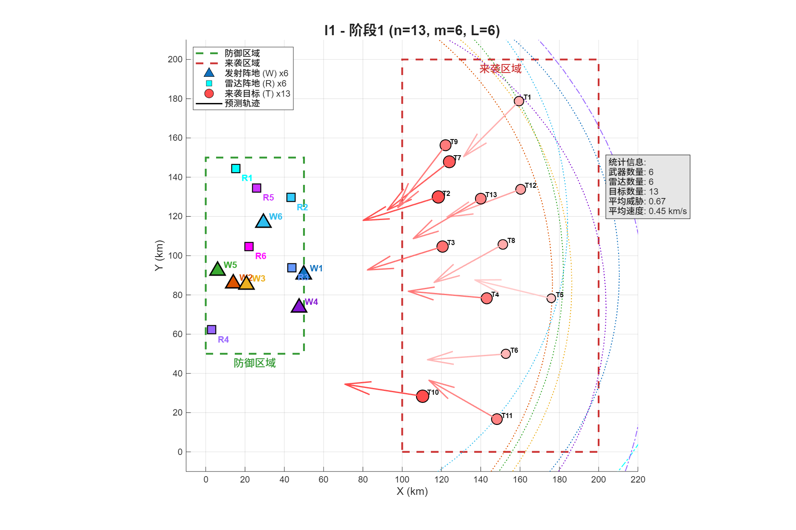
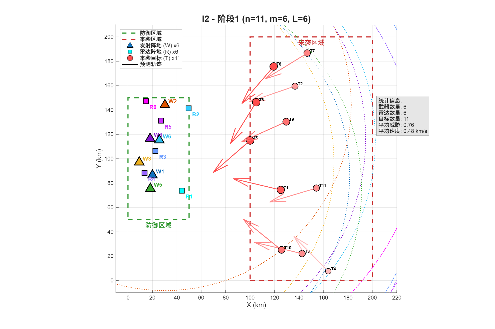
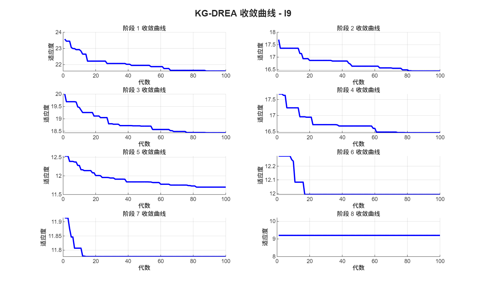
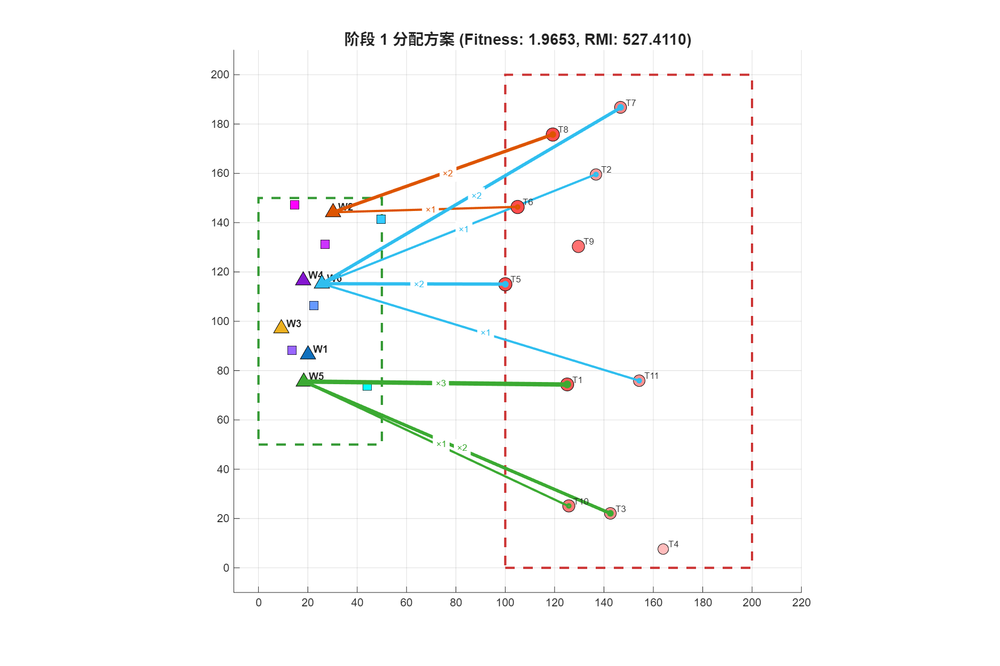
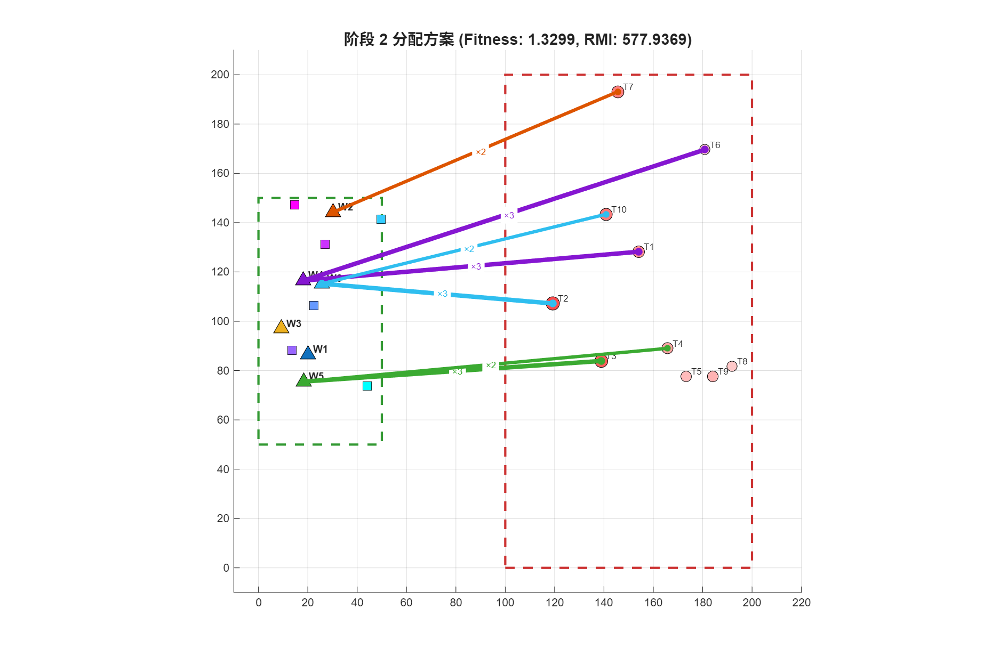
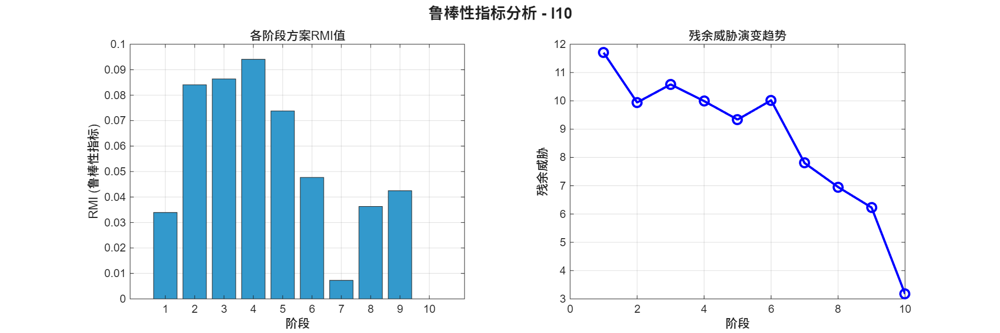
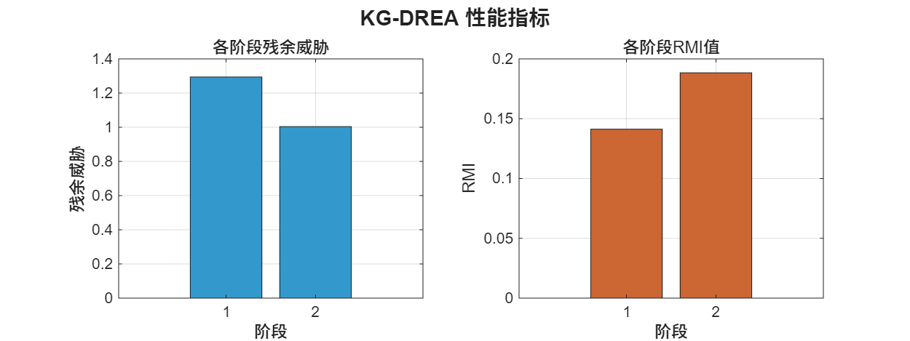

# D-POWTA: 动态时序武器目标分配问题

<div align="center">


**基于知识引导的动态武器目标分配进化算法**

</div>

---

## 项目简介

**D-POWTA**（Dynamic Phase-Ordered Weapon Target Assignment）专注于解决动态时序武器目标分配问题，这是防空作战中的经典组合优化难题。本项目实现了**KG-DREA算法**（Knowledge-Guided Differential Evolution Algorithm，知识引导差分进化算法），包含基准算例和对比算法。

### 核心特性

- **多阶段优化**：处理跨多个时间阶段的序贯决策问题
- **知识引导进化**：融合领域知识加速收敛
- **鲁棒性评估**：采用RMI（Robustness Measure Index）评估解的可靠性
- **约束处理**：预处理与修复机制应对复杂作战约束
- **完整基准算例**：10个复杂度递增的测试算例

---

## 问题描述

武器目标分配（WTA）问题是军事运筹学中的经典优化问题。动态变体（D-POWTA）考虑以下场景：

```
                    ┌─────────────────────────────────────┐
  来袭目标 ────────► │  阶段1  →  阶段2  →  ...  →  阶段T  │
                    └─────────────────────────────────────┘
                          ↓            ↓                      ↓
                      已分配武器     已分配武器             已分配武器
```

**主要约束条件**：
- 雷达探测概率门限
- 武器交战包线（射程、反应时间）
- 单武器平台弹药有限
- 打击窗口时间约束

---

## KG-DREA算法

知识引导差分进化算法（KG-DREA）结合了：

1. **差分进化**基础算子（变异、交叉、选择）
2. **知识库**追踪成功分配模式
3. **小生境保存**通过汉明距离共享
4. **RMI选择**确保鲁棒性

```
┌──────────────────────────────────────────────────────────────┐
│                    KG-DREA 算法框架                         │
├──────────────────────────────────────────────────────────────┤
│  for each phase t = 1 to T:                                 │
│    ├── 约束预处理 (A_jt 构建)                                │
│    ├── 知识引导种群初始化                                     │
│    ├── while g < G_max:                                     │
│    │   ├── 知识引导变异与交叉                                 │
│    │   ├── 小生境环境选择                                    │
│    │   └── 更新适应度历史                                    │
│    ├── ε-近似解集构建                                        │
│    ├── RMI评估与最优解选择                                   │
│    └── 知识库更新                                            │
└──────────────────────────────────────────────────────────────┘
```

### 关键参数

| 参数 | 默认值 | 说明 |
|------|--------|------|
| `N` | 100 | 种群规模 |
| `G_max` | 100 | 最大迭代代数 |
| `δ` | 3 | 小生境半径 |
| `p_crossover` | 0.8 | 交叉概率 |
| `p_mut` | 0.1 | 变异概率 |
| `p_guided` | 0.7 | 知识引导概率 |
| `S` | 50 | RMI蒙特卡洛采样数 |

---

## 项目结构

```
D-POWTA/
├── _core/                      # 核心算法模块
│   ├── generate_instances.m    # 算例生成器
│   ├── solve_kgdrea.m          # KG-DREA求解器
│   ├── constraint_preprocess.m # 约束预处理
│   ├── encoding_decode.m       # TC-FCE编码
│   ├── knowledge_manager.m     # 知识库管理
│   └── rmi_evaluator.m         # 鲁棒性评估
├── _operators/                 # 进化算子
│   ├── crossover.m             # 均匀交叉
│   ├── mutation.m              # 知识引导变异
│   ├── repair_constraints.m     # 约束修复
│   ├── init_population.m       # 种群初始化
│   └── niche_selection.m       # 小生境选择
├── _visualization/              # 可视化工具
│   ├── plot_instance.m         # 算例场景绘制
│   ├── plot_allocation.m       # 分配方案可视化
│   ├── plot_convergence.m      # 收敛曲线
│   ├── plot_robustness.m       # 鲁棒性指标
│   └── plot_comparison.m       # 算法对比
├── _utils/                     # 工具函数
│   ├── load_instance.m         # 算例加载
│   ├── compute_distance.m       # 距离计算
│   ├── is_in_conflict.m        # 冲突检测
│   └── get_complement_set.m    # 补集计算
├── config/                     # 配置文件
│   └── default_params.m        # 默认参数
├── instances/                  # 测试算例 (I1.mat - I10.mat)
├── results/                    # 输出结果
├── competitor algorithms/      # 对比算法 (GA, HA, LKEA)
├── main.m                     # 主程序入口
├── demo.m                     # 快速演示脚本
└── run_all_instances.m        # 批量运行脚本
```

---

## 快速开始

### 求解指定算例

```matlab
TestInstanceNum = 1;  % 修改为1-10可选择不同算例
main
```

### 对比算法

```matlab
cd 'competitor algorithms'
HA    % 启发式算法
GA    % 遗传算法
LKEA  % 局部知识进化算法
run_all_instances  % KG-DREA运行所有算例
```

### 批量运行

```matlab
run_all_instances  % KG-DREA运行所有算例
```

---

## 测试算例

基准算例集包含10个复杂度递增的测试算例：

| 算例 | 目标数 | 武器数 | 雷达数 | 阶段数 | 复杂度 |
|------|--------|--------|--------|--------|--------|
| I1 | 5 | 4 | 3 | 2 | ★☆☆☆☆ |
| I2 | 6 | 5 | 4 | 3 | ★★☆☆☆ |
| I3 | 8 | 6 | 4 | 4 | ★★☆☆☆ |
| I4 | 10 | 6 | 5 | 5 | ★★★☆☆ |
| I5 | 12 | 8 | 6 | 8 | ★★★☆☆ |
| I6 | 15 | 8 | 6 | 5 | ★★★★☆ |
| I7 | 18 | 10 | 8 | 10 | ★★★★☆ |
| I8 | 20 | 10 | 8 | 6 | ★★★★★ |
| I9 | 25 | 12 | 8 | 8 | ★★★★★ |
| I10 | 30 | 12 | 10 | 10 | ★★★★★ |

---

## 结果可视化

### 算例场景
 

### 收敛曲线


### 分配方案可视化
 

### 鲁棒性分析


### 性能对比


---

## 对比算法

本项目还包含三个对比算法用于基准测试：

| 算法 | 描述 | 参考 |
|------|------|------|
| **GA** | 遗传算法（标准算子） | 经典基准 |
| **HA** | 启发式算法（贪婪策略） | 规则驱动 |
| **LKEA** | 局部知识进化算法 | 知识引导方法 |

---

## 数据结构

### 算例结构

```matlab
instance = struct(
    'name',           % 算例名称（如 'I1'）
    'n',              % 目标总数
    'm',              % 武器平台数量
    'L',              % 雷达数量
    'T_total',        % 总阶段数

    % 武器参数
    'weapon_x',       % 武器X坐标
    'weapon_y',       % 武器Y坐标
    'R_max',          % 最大交战射程
    'tau_react',      % 反应时间
    'ammo',           % 载弹量

    % 雷达参数
    'radar_x',        % 雷达X坐标
    'R_radar',        % 探测距离
    'lambda',         % 雷达性能参数

    % 目标参数
    'targets',        % 目标结构体数组

    % 预计算矩阵
    'P_ij',           % 毁伤概率矩阵
    'eta_j',          % MRFDQI探测质量指数
    'd_ij'            % 武器-目标距离
);
```

---

## 开源许可

本项目基于 MIT 许可证开源，详见 [LICENSE](LICENSE) 文件。

---

## 致谢

- 感谢研究团队提供的宝贵讨论与建议
- 算例生成参考了相关领域研究成果

---

<div align="center">

**如果本项目对你的研究有帮助，请给个 ⭐**

</div>
